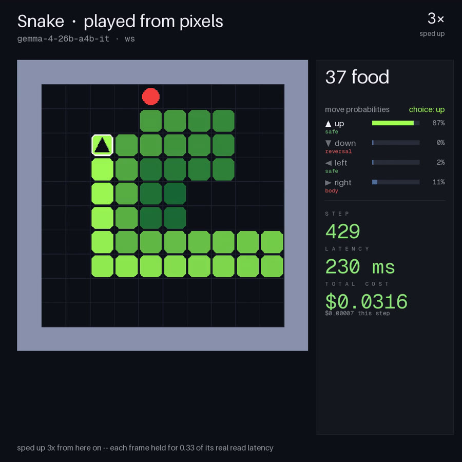
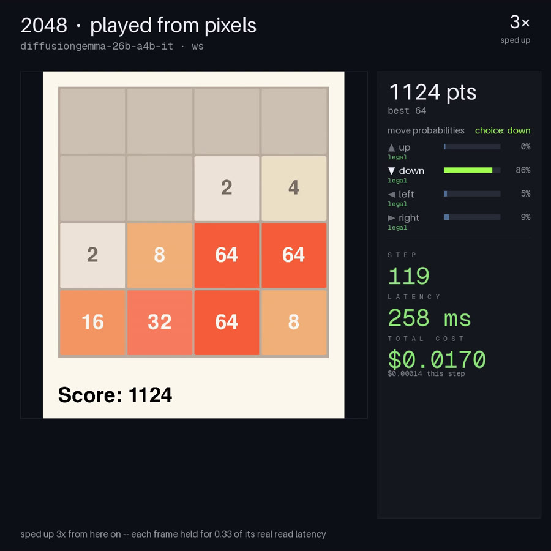
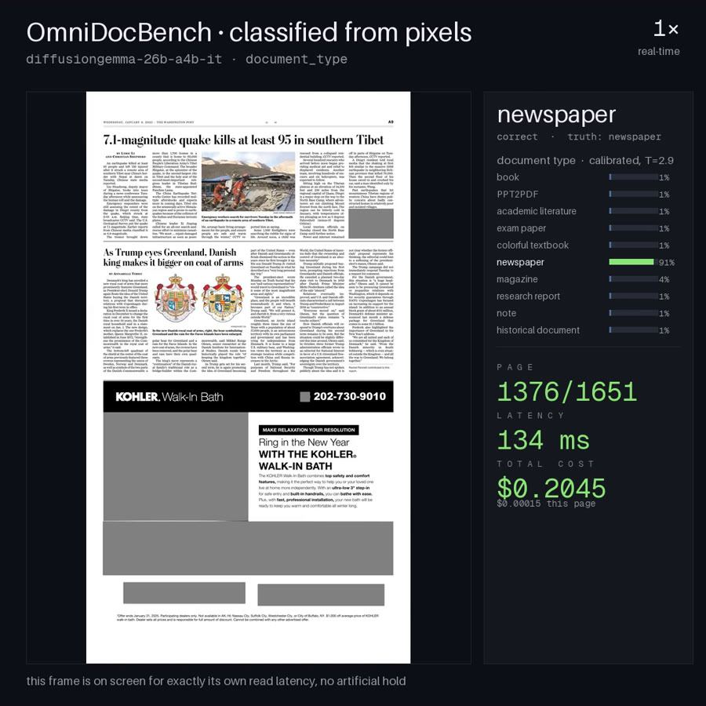

# System One demos

Typed, calibrated decisions from pixels through the VLM Run gateway's
[System One](https://docs.vlm.run/gateway/system-one) route. Each script hands the model one rendered state and asks
typed questions. The answers come back as a calibrated distribution over exactly the legal labels, so an illegal action
cannot even be expressed. The model is a sensor; the script owns the geometry, the rules and the safety checks.

<table>
<tr>
<td width="42%" valign="top" align="center">
<a href="pixelgames.py"></a>
<sub>87% on <code>up</code>, the only free move toward the food. <code>right</code> is discounted to 11% because its own body blocks it.</sub>
</td>
<td valign="top">

**[`pixelgames.py snake`](pixelgames.py)**: snake, played from pixels.

- **In:** one board frame per move, arrow drawn on the head, solid wall band.
- **Asks:** bearing to food, own heading. The two distributions are multiplied, not picked between.
- **Result:** **beats its baseline**: 87 food / 3000 moves, no deaths, vs greedy BFS 75 and random-among-safe 33.
- Survival is a local tail-reachability veto in the script, not the model.

</td>
</tr>
<tr>
<td width="42%" valign="top" align="center">
<a href="pixelgames.py"></a>
<sub>86% on <code>down</code>, merging the two 64s into a 128 and keeping the big tiles on the bottom row.</sub>
</td>
<td valign="top">

**[`pixelgames.py 2048`](pixelgames.py)**: 2048, played from pixels.

- **In:** one rendered board picture per move.
- **Asks:** one question, four labels. A local no-op guard takes the next choice when a slide moves nothing.
- **Result:** **below baseline**: median 1800 clears random 920 but loses to fixed-rule bots at 2258–2418.
- Its first choice is only ever `down` or `right`, never `up` or `left`.

</td>
</tr>
<tr>
<td width="42%" valign="top" align="center">
<a href="classify_docs.py"></a>
<sub>A Washington Post page read as <code>newspaper</code> at 91% after calibration, in 134 ms.</sub>
</td>
<td valign="top">

**[`classify_docs.py`](classify_docs.py)**: OmniDocBench pages by document type.

- **In:** one page image per decision, all 1651 unique pages, 10 categories from the dataset's own `page_attribute.data_source`.
- **Result:** **beats its baseline**: 57.7% top1 / 71.1% top2 / 80.5% top3 vs always-`book` 16.7% and uniform 10.0%.
- p50 133 ms; `usage.cost` reports $0.001 a page today.
- Raw confidence is uncalibrated: `T=2.9` takes ECE 0.262 → 0.041 with accuracy unchanged.

</td>
</tr>
</table>

## Run

Each script is a self-contained [uv](https://docs.astral.sh/uv/) script, so there is nothing to install first:

```sh
export VLMRUN_API_KEY=<key>    # required; get one at https://app.vlm.run/dashboard

uv run classify_docs.py --n-per-category 3 --mp4      # 30 pages and a reel
uv run classify_docs.py --all --ws -c 8               # all 1651 pages, 8 reads in flight
uv run pixelgames.py snake --ws --episodes 5 --mp4
uv run pixelgames.py snake --baseline                 # random among safe moves, no API calls
uv run pixelgames.py 2048 --ws --episodes 20 --mp4
```

No clone needed, since `uv run` takes a URL:

```sh
uv run https://raw.githubusercontent.com/vlm-run/vlmrun-cookbook/main/demos/systemone/classify_docs.py --n-per-category 1
```

- `--model` picks the engine; `GET https://gateway.vlm.run/typesafe/v1/models` lists them. `TYPESAFE_DEFAULT_MODEL`
  and `TYPESAFE_BASE_URL` change the defaults.
- `--ws` keeps one [WebSocket session](https://docs.vlm.run/gateway/typesafe-streaming) for the whole run instead of
  sending one POST per read.
- `--mp4` writes H.264 through PyAV, so you don't need a system `ffmpeg`. Each frame stays on screen for its own read
  latency, so the reel plays at the real decision rate.
- Downloads and reads are cached in `~/.cache/vlmrun-systemone` (set `SYSTEMONE_CACHE` to move it). Re-running a command
  replays it with no API calls, which is how you re-render a reel for free. Delete the folder to read fresh.

## Adding a demo

People will read code here more often than they run it, so keep it to these rules:

- **One file, one `uv run`.** Declare dependencies, with lower bounds, in a [PEP 723](https://peps.python.org/pep-0723/)
  block. Don't add a `requirements.txt` or local imports: `uv run <raw URL>` has to work.
- **The fewest lines that still read well.** Use the SDK rather than rebuilding the wire protocol:
  `VLMRun().gateway.systemone.stream(...)` covers both POST and WS, and `usage_of(response)["cost"]` gives the cost. Use
  comprehensions, `functools.partial`, `@contextmanager` and the walrus operator where they save lines, and let
  `typer.run(main)` turn the function signature into the CLI. Don't add a flag you haven't measured.
- **Retries:** wrap network calls, and only network calls, in [tenacity](https://tenacity.readthedocs.io)'s `@retry`.
- **Caching:** use `functools.cache` in memory. For anything that costs money or a download, use `cachetools.cached`
  over a [`diskcache.Cache`](https://grantjenks.com/docs/diskcache/), so a rerun is free. `vlmrun` already depends on
  tenacity, cachetools, typer and rich.
- **Prove the claim:** print every number the claim needs, and write it to JSON: the score against a chance or no-API
  baseline, p50 latency and cost.
- **Ship a thumbnail, not the video:** a JPEG under 100 KB in `images/`, with a caption saying what the frame shows.
- **Format and lint** with `uvx ruff format && uvx ruff check` (settings in [`ruff.toml`](ruff.toml)).
